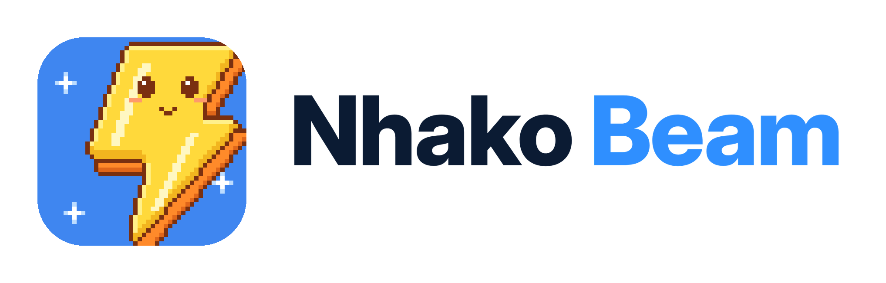
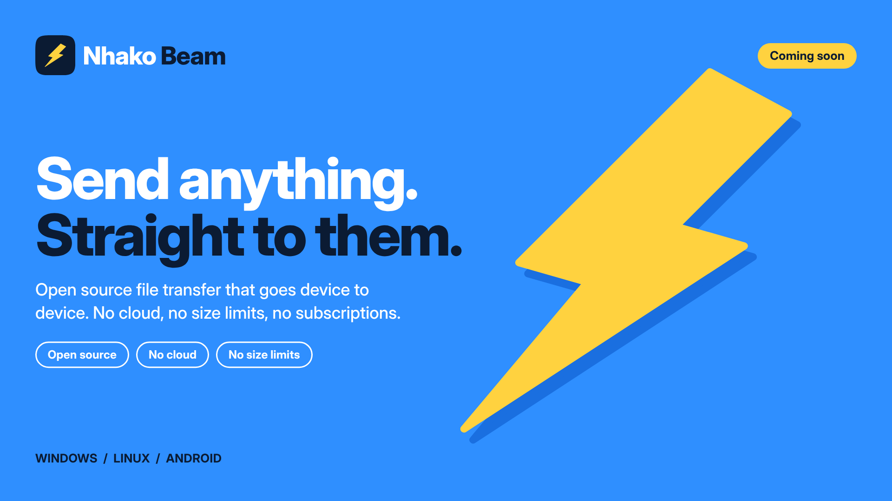
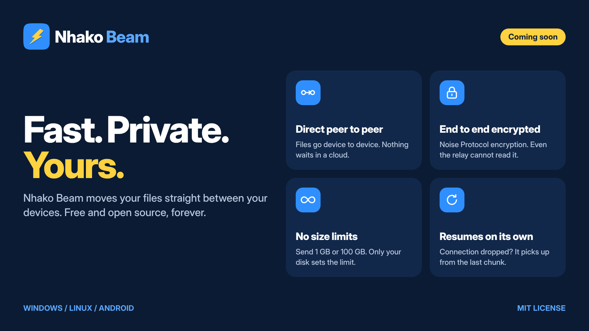
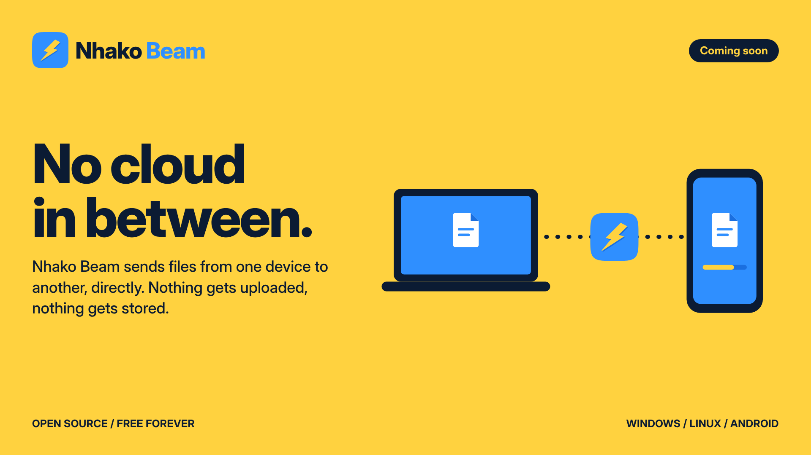
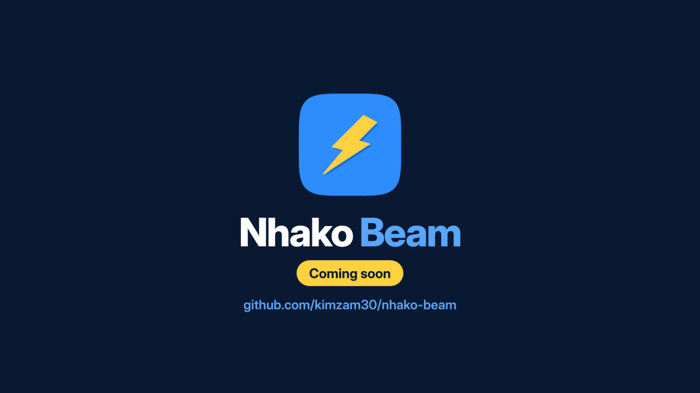
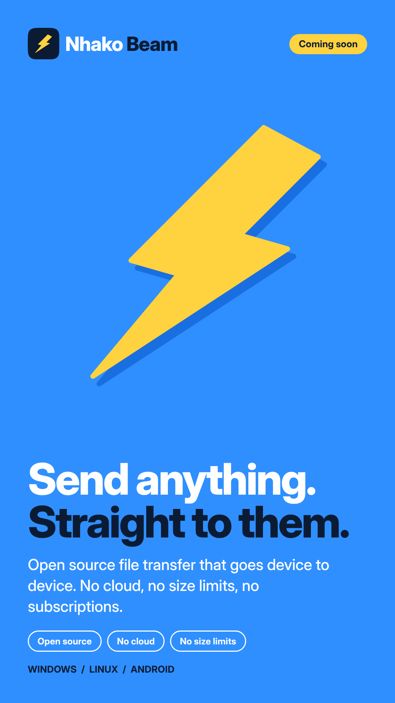
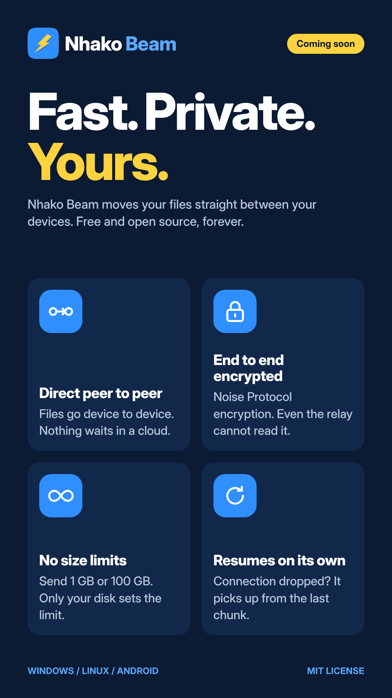
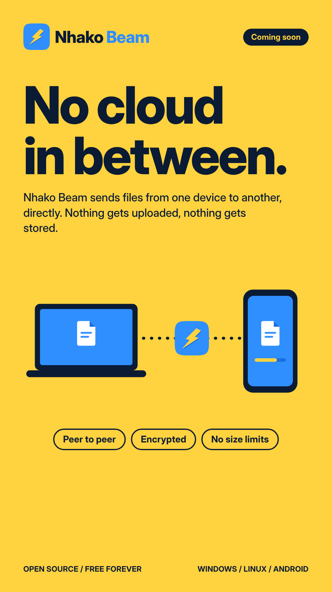

<div align="center">

<picture>
  <source media="(prefers-color-scheme: dark)" srcset="docs/brand/logo/png/nhako-beam-logo-horizontal-dark.png">
  
</picture>

### Send files straight between your own devices.
**No cloud. No size limit. No account.**

[](#project-status)
[](#install)
[](#license)
[](https://rustup.rs)
[](https://iroh.computer)

[Features](#features) · [Install](#install) · [How it works](#how-it-works) · [Self-hosting](#run-your-own-server) · [Development](#development) · [Brand kit](#brand-kit)

<br>



</div>

<br>

## Overview

Nhako Beam moves files directly from one of your devices to another: a phone to a laptop, a
desktop to a tablet. On the same Wi-Fi they find each other by themselves. Across the internet
they connect directly when they can, and through a relay when they can't. Either way the files
are encrypted end to end and never stored anywhere in between.

|  |  |
|---|---|
| **No cloud** | Files go device to device. Nothing is uploaded or kept on a server. |
| **No size limit** | Only your disk decides. A dropped connection picks up from the last confirmed byte. |
| **No account** | Devices pair once with a four-word code or a QR code, and remember each other. |
| **Your own servers, if you want** | The relay and address lookup run on any computer with Docker. By default the apps use n0's free public ones. |
| **Free and open source** | MIT or Apache 2.0. No ads, no tracking, no subscription. |

It's an open alternative to apps like Blip.

## Features

<table>
<tr>
<td width="50%" valign="top">

#### Sending and receiving
- Drag files onto a device (desktop), pick or share them from any app (Android), or
  right-click **Send with Nhako Beam** in Explorer or Files.
- A request card with **Accept** and **Decline**, or files straight in from devices you trust.
- Notifications with Accept and Decline buttons while the app is in the background.
- **Send with a code** to a device you haven't paired with.
- Folders (kept in shape), text, links and the clipboard.
- **Share via link** to any browser on the same Wi-Fi, no app needed.

</td>
<td width="50%" valign="top">

#### Transfers you can rely on
- Pause, resume, cancel, and retry from the last confirmed byte.
- Every file is checked with BLAKE3 before it's saved.
- Full **history** of everything sent and received, with Open and Show in folder.
- Transfers on Android keep going with the screen off.

</td>
</tr>
<tr>
<td valign="top">

#### Desktop (Windows and Linux)
- Tray icon with a quick view of your devices and transfers.
- Starts at login (offered during setup), and keeps running in the tray when the window is closed.
- Explorer and Files integration for sending from the file manager: with the window closed, the
  tray popover opens to pick a device.

</td>
<td valign="top">

#### Android
- **Always ready to receive**, from the moment the phone starts, with a quiet notification.
- Share from any app: the Send sheet opens over it, and your trusted devices are in the share
  sheet itself.
- A **Receive** tile in Quick Settings.
- Shrunk release builds, one APK per phone type (17 MB on arm64).
- Optional push wake-up, so your other devices can reach the phone while the app is closed
  ([wake/README.md](wake/README.md)).

</td>
</tr>
<tr>
<td valign="top">

#### Feel
- Animated everywhere, with a reduced motion mode.
- Original sounds for every interaction: **Loud**, **Soft** (default) or **Off**.
- Light and dark themes, and a short launch intro.

</td>
<td valign="top">

#### Privacy and control
- Turn finding nearby devices on or off.
- **Who can send to me**: only your own devices by default, or everyone nearby.
- A quiet once-a-day check for new versions, with a switch.
- Point the apps at your own relay and lookup server.
- Every open source package used is listed under Settings > About > Open source licenses.

</td>
</tr>
</table>

<div align="center">


</div>

## Install

There are no store releases yet. You can build the apps yourself (free; the scripts check what you
need and tell you what's missing), or run the **Build** workflow on GitHub and download the files
from the run's Artifacts.

| Platform | Build it | Install it |
|---|---|---|
| **Android** 8.0+ | `scripts/build-android.sh` | Copy `out/nhako-beam-arm64-v8a.apk` to the phone and tap it |
| **Linux** (Debian, Ubuntu) | `scripts/build-linux.sh` | `sudo apt install --reinstall ./out/*.deb` |
| **Windows** 10/11 | `scripts\build-windows.ps1` | Run the installer in `out\` |

Step by step, including which APK your phone needs and how to install it:
[docs/building.md](docs/building.md).

> [!NOTE]
> The Windows installer isn't signed yet, so SmartScreen shows a warning. Android APKs are signed
> with the building computer's debug key until there's a Play Store release key.

## Usage

**In the apps:** open Nhako Beam on both devices. On the same Wi-Fi they show up under Nearby.
Pair once with the four-word code or the QR code and check that both screens show the same short
value. After that, send by dropping or sharing files onto the device.

**From the command line:** `nhako` is a small client of the same engine.

```bash
cargo build --release -p nhako-cli        # binary: target/release/nhako

nhako send holiday.mp4 notes.pdf          # prints four words for the other device
nhako receive river lantern seven harbor  # on the other device

nhako pair                                # pair once, then send by name
nhako send report.pdf --to "Work phone"
nhako devices                             # see who's around
```

All commands: [cli/README.md](cli/README.md).

## How it works

```
  Phone (Kotlin, Compose)          Laptop (Svelte in Tauri)
            │                                 │
            └───── the same engine (Rust) ────┘
                           │
              iroh: QUIC, end to end encrypted
              ├─ same Wi-Fi: found with mDNS, connects directly
              ├─ internet: hole punching, direct when possible
              └─ otherwise: through a relay (n0's, or your own)
```

- **One engine for every app.** `core/` is written in Rust on [iroh](https://iroh.computer):
  device keys, discovery, pairing codes and the `nhako/1` transfer protocol
  ([docs/protocol/nhako-1.md](docs/protocol/nhako-1.md)). The desktop apps run it inside Tauri;
  the Android app runs it through UniFFI (`ffi/`).
- **Fast.** The engine moves about 360 MB/s for one big file and about 230 MB/s for a folder of 5,000 photos in its own benchmark (`scripts/bench.sh`).
- **Shared design.** Colors, type, spacing, motion, UI copy and sounds each come from one source
  and are built for both the desktop and Android apps.

### Security and privacy

- Each device has its own key. Connections are encrypted and authenticated between the two device
  keys (QUIC with TLS 1.3, through iroh).
- Pairing codes live 10 minutes and work once. Both screens show a check value derived from both device keys, so
  a stranger who overheard the code can't step in between.
- Relays only pass encrypted bytes along. They can't read your files.
- Device names are only sent inside an encrypted connection, never published.
- No analytics and no accounts. The optional wake push carries nothing but "wake up".

## Run your own server

The relay and lookup server are n0's own open source servers in Docker. They run on any computer,
for free.

```bash
cd relay
cp .env.example .env            # put a token in it: openssl rand -hex 24
docker compose up -d --build
```

Then on each device: **Settings > Connection > Your own**. Details in
[relay/README.md](relay/README.md).

## Development

**Requirements:** Rust 1.91+, Node 20 or newer (CI uses 22), and for Android: JDK 17+, the Android SDK with NDK
`29.0.14206865`, the three Rust Android targets and `cargo-ndk`. For the Linux app: the GTK,
WebKit and ALSA development packages. Full setup in [docs/building.md](docs/building.md).

**Try the UI in a browser** (a working prototype on a pretend engine, no Rust needed):

```bash
cd desktop
npm install
npm run dev
```

**Checks** to run before a pull request:

```bash
cargo fmt --all -- --check
cargo clippy --workspace --all-targets -- -D warnings
cargo test --workspace
cd desktop && npm run check && npm test && npm run e2e
cd android && ./gradlew testDebugUnitTest
```

### Project structure

| Folder | What's there |
|---|---|
| [`core/`](core) | The engine (Rust, iroh 1.3): identity, discovery, pairing, the `nhako/1` protocol |
| [`cli/`](cli) | `nhako`, a command-line client |
| [`ffi/`](ffi) | The engine for other languages (UniFFI), used by Android |
| [`desktop/`](desktop) | The Windows and Linux app: Svelte 5 UI, Tauri 2 shell in `src-tauri/` |
| [`android/`](android) | The Android app (Kotlin, Jetpack Compose) |
| [`relay/`](relay) | Your own relay and lookup server (Docker) |
| [`wake/`](wake) | The optional wake service for phones (Cloudflare Worker, Firebase push) |
| [`design/`](design) | Design tokens and the sound generator, built for both apps |
| [`docs/`](docs) | Design system, screens and states, UI copy, motion spec, protocol, brand kit |
| [`scripts/`](scripts) | Local build scripts and the open source licenses list |

## Project status

Version **0.1.0**, in active development and tested on real devices (Linux on Zorin OS and Android
on a Galaxy S24+).

| Phase | Done |
|---|---|
| 0 to 2 | Design system, every screen and state, UI copy, motion, the browser prototype |
| 3 | The engine, the CLI, the protocol |
| 4 | Your own relay and lookup server |
| 5 and 6 | The Linux and Windows apps |
| 7 | The Android app |
| 8 | Brand and icons, launch intro, history, licenses, tray quick view, notification buttons, nearby switch, Quick Settings tile, push wake-up, smaller APKs |
| 9 | Sounds for every interaction on both apps, and fixes from real-device testing |
| 10 | Nearby discovery on Windows (the beacon), a log file, Copy diagnostics |
| 11 | Security: four-word codes, Who can send to me, safer files and names |
| 12 | Performance: thousands of files, faster resumes, less battery in the background |
| 13 | The bolt motion pass on both apps |
| 14 | Folders, text, links and the clipboard, Trust this device from Nearby |
| 15 | Accessibility, Share via link, the update check, Flathub, F-Droid and winget builds |
| 16 and 17 | Fixes from a full audit, and cleanup |
| 18 and 19 | Cleanup, and Windows finding nearby devices on its own (a firewall rule at install) |
| 20 | Always ready to receive: the phone from the moment it starts, the desktop from login; send from the share sheet or the file manager without opening the app |

**Next:** more real-device testing (especially across the internet), signed Windows builds, and a
Play Store release.

## Media

### Launch video

<div align="center">
<a href="docs/brand/video/nhako-beam-launch-16x9.mp4">
  
</a>
<br>
<sub>Click to watch. Also in
<a href="docs/brand/video/nhako-beam-launch-1x1.mp4">1:1</a>,
<a href="docs/brand/video/nhako-beam-launch-4x5.mp4">4:5</a> and
<a href="docs/brand/video/nhako-beam-launch-9x16.mp4">9:16</a>.</sub>
</div>

### Posters

<div align="center">



</div>

<details>
<summary><b>Every poster and size</b></summary>
<br>

| Poster | 16:9 | 1:1 | 4:5 | 9:16 |
|---|---|---|---|---|
| Hero | [PNG](docs/brand/posters/nhako-beam-poster-hero-16x9.png) | [PNG](docs/brand/posters/nhako-beam-poster-hero-1x1.png) | [PNG](docs/brand/posters/nhako-beam-poster-hero-4x5.png) | [PNG](docs/brand/posters/nhako-beam-poster-hero-9x16.png) |
| Features | [PNG](docs/brand/posters/nhako-beam-poster-features-16x9.png) | [PNG](docs/brand/posters/nhako-beam-poster-features-1x1.png) | [PNG](docs/brand/posters/nhako-beam-poster-features-4x5.png) | [PNG](docs/brand/posters/nhako-beam-poster-features-9x16.png) |
| No cloud | [PNG](docs/brand/posters/nhako-beam-poster-no-cloud-16x9.png) | [PNG](docs/brand/posters/nhako-beam-poster-no-cloud-1x1.png) | [PNG](docs/brand/posters/nhako-beam-poster-no-cloud-4x5.png) | [PNG](docs/brand/posters/nhako-beam-poster-no-cloud-9x16.png) |
| Launch video | [MP4](docs/brand/video/nhako-beam-launch-16x9.mp4) | [MP4](docs/brand/video/nhako-beam-launch-1x1.mp4) | [MP4](docs/brand/video/nhako-beam-launch-4x5.mp4) | [MP4](docs/brand/video/nhako-beam-launch-9x16.mp4) |

GitHub social preview (1280x640): [nhako-beam-github-social-preview.png](docs/brand/posters/nhako-beam-github-social-preview.png)

</details>

## Brand kit

Everything lives in [`docs/brand/`](docs/brand), in SVG and PNG. The icon is the Nhako Beam
mascot: a smiling pixel-art lightning bolt in a sparkly blue sky, one of the seven Nhako mascots
drawn on a 48px grid by `scripts/mascots.py` in
[Nhako-home](https://github.com/kimzam30/Nhako-home). Its `scripts/brand_assets.py` writes every
icon size, the Android launcher vectors and the logo lockups here.

<table>
<tr>
<td align="center" width="25%"><br><sub><b>Icon</b></sub></td>
<td align="center" width="25%"><br><sub><b>Circle</b></sub></td>
<td align="center" width="25%"><br><sub><b>Mono</b></sub></td>
<td align="center" width="25%"><br><sub><b>Bolt</b></sub></td>
</tr>
</table>

| Asset | Files |
|---|---|
| App icon | [SVG](docs/brand/logo/svg/nhako-beam-icon.svg), PNG at 16 to 1024 px, [favicon.ico](docs/brand/logo/favicon.ico) |
| Horizontal logo | [light](docs/brand/logo/svg/nhako-beam-logo-horizontal-light.svg), [dark](docs/brand/logo/svg/nhako-beam-logo-horizontal-dark.svg) |
| Stacked logo | [light](docs/brand/logo/svg/nhako-beam-logo-stacked-light.svg), [dark](docs/brand/logo/svg/nhako-beam-logo-stacked-dark.svg) |
| Wordmark | [light](docs/brand/logo/svg/nhako-beam-wordmark-light.svg), [dark](docs/brand/logo/svg/nhako-beam-wordmark-dark.svg) |
| Mono icons | [navy](docs/brand/logo/svg/nhako-beam-icon-mono-navy.svg), [white](docs/brand/logo/svg/nhako-beam-icon-mono-white.svg) |

| Color | Hex | Use |
|---|---|---|
| Sky blue | `#3F86F0` | The icon's ground and the Android splash |
| Blue | `#2F8FFF` | The beam glow |
| Dark blue | `#1A6FE0` | The accent in the apps (white text on it passes contrast) |
| Yellow | `#FFD23F` | Highlights. Never as text on white |
| Ink | `#0B1B33` | The wordmark on light backgrounds |

"Light" logos are for light backgrounds, "dark" logos for dark ones. The design system, motion
spec and UI copy are in [`docs/design/`](docs/design).

## Contributing

Issues and pull requests are welcome. Before opening a pull request, please run the
[checks](#development). A few things are kept in step across the codebase (the JSON contract, UI
copy, design tokens, sounds and app behavior on desktop and Android); [CLAUDE.md](CLAUDE.md)
lists them.

## License

Licensed under either of

- MIT license ([LICENSE-MIT](LICENSE-MIT))
- Apache License, Version 2.0 ([LICENSE-APACHE](LICENSE-APACHE))

at your option. Unless you say otherwise, any contribution you submit for inclusion is dual
licensed as above, without any additional terms.

## Acknowledgments

Built on [iroh](https://iroh.computer) by n0, [Tauri](https://tauri.app),
[Svelte](https://svelte.dev), [Jetpack Compose](https://developer.android.com/compose) and
[UniFFI](https://github.com/mozilla/uniffi-rs). Icons from [Phosphor](https://phosphoricons.com),
type in [Inter](https://rsms.me/inter/).

<div align="center">
<br>

<br>
<sub>Made for moving your own files, your own way.</sub>
</div>
